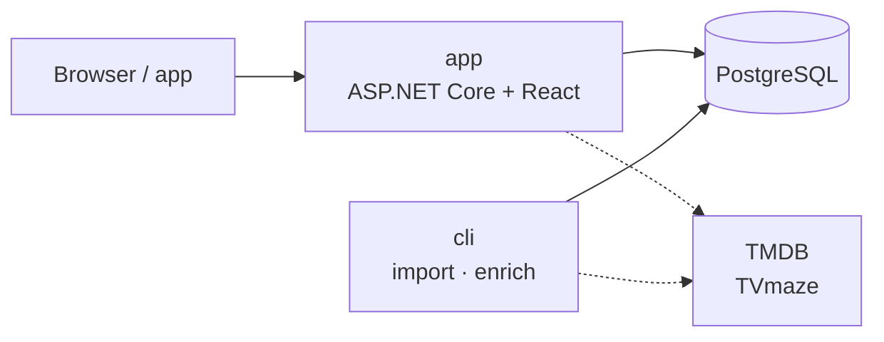

<div align="center">


# Reprise

**A self-hosted TV show tracker built around rewatching.**

I built it when TV Time shut down and took everyone's watch history with it.

[](https://github.com/GabrielfSilveiraDev/reprise/actions/workflows/ci.yml)
[](LICENSE)


[Português](README.pt-BR.md) · [Get started](#get-started) · [On your computer](#on-your-computer) · [From anywhere](#from-anywhere-for-free) · [On your phone](#on-your-phone) · [Docs](#documentation)


</div>

> [!NOTE]
> The interface is in Brazilian Portuguese, and so are the code comments and the in-depth docs.

## Why

Most trackers store "watched" as a checkbox. That breaks the moment you rewatch a show: the
checkbox is already ticked, so the second time through leaves no trace. Reprise is built on one
rule:

> **A watch is an event, not a boolean.**

Every time you watch an episode, a row is appended to `watch_events`. Progress, rewatch counts,
streaks and monthly stats are all *derived* from that log — never mutable state kept in sync.

## Features

- **Import from TV Time** — reads the GDPR export, idempotently (re-running never duplicates) and
  with a reconciliation report that proves every row was accounted for.
- **Up next** — the next episode of every show you watched in the last month, rewatches included, marked
  with one tap and an undo.
- **Episode map** — one square per episode, colored by how many times you've seen it.
- **Release calendar** — upcoming episodes in *your* time zone, combining TMDB dates with TVmaze
  air times, because a date without a time zone is how "aired today" shows up a day early.
- **Stats** — screen time, streaks, a yearly heatmap, and where your time went, each chart with
  the table behind it.
- **Three designs**, each with light and dark themes, picked per browser.
- **Phone app** — installable from the browser (Android and iPhone) or as an APK, and it updates
  itself.
- **Your data, portable** — a complete, rebuildable JSON export of every watch.
- **Multi-user** — each person with their own login and history.

## Screenshots

| Brasa | Sessão | Grade |
|:---:|:---:|:---:|
|  |  |  |

<table>
  <tr>
    <td width="70%"></td>
    <td width="30%"></td>
  </tr>
  <tr>
    <td colspan="2"></td>
  </tr>
</table>

*Screenshots come from the end-to-end test suite, running against a mocked API with made-up shows.*

## Get started

Pick how you want to use it. You can start with one and move to another later, history included.

| I want to… | Path | Cost | Needs |
|---|---|---|---|
| Use it on my computer | [On your computer](#on-your-computer) | free | Docker |
| Use it from anywhere, no PC left on | [From anywhere](#from-anywhere-for-free) | free | Neon and Render accounts |
| Use it on my phone | [On your phone](#on-your-phone) | free | a hosted Reprise (row above) |

## On your computer

1. **Install Docker.** Get [Docker Desktop](https://www.docker.com/products/docker-desktop/) for
   Windows, macOS or Linux, install it and open it.
2. **Get Reprise** — `git clone https://github.com/GabrielfSilveiraDev/reprise.git && cd reprise`,
   or **Code → Download ZIP** on the project page and open a terminal in the unzipped folder.
3. **Start it:**

   ```bash
   docker compose up -d --build
   ```

   The first run takes a few minutes. Then open **http://localhost:8080**. Nothing needs
   configuring first: the token signing secret is generated on first start. To change the port or
   other options, copy [`.env.example`](.env.example) to `.env`.
4. **Create your account.** Sign-up is closed by default, so the account comes from the CLI:

   ```bash
   docker compose run --rm cli passwd --email me@reprise.local --password "at-least-10-chars" --user yourname
   ```

   Log in with the username and password. `me@reprise.local` is the built-in owner account — the
   one the TV Time import writes to.
5. **Bring your TV Time history (optional).** Put the export `.zip` in `./gdpr-data`, then:

   ```bash
   docker compose run --rm cli /data/your-export.zip --dry-run   # check, writes nothing
   docker compose run --rm cli /data/your-export.zip             # import
   docker compose run --rm cli enrich                            # fill the catalog from TMDB
   ```

   `enrich` and searching for new shows need a free
   [TMDB API key](https://www.themoviedb.org/settings/api) in `Tmdb__ApiKey` (in `.env`).
   Everything else works without one.

To update: `git pull` then `docker compose up -d --build --remove-orphans` (the flag clears
containers of services that no longer exist, such as the old `api` and `web`). Logs: `docker compose logs app`. Your
history lives in the `reprise_reprise-pgdata` Docker volume — never use Docker Desktop's "Reset to
factory defaults", which deletes volumes.

## From anywhere, for free

Reprise hosted on [Render](https://render.com) with the database on [Neon](https://neon.com). Both
have free plans with no credit card, and your PC can stay off:

1. Create a Neon project and copy its connection URL.
2. On Render, **New → Blueprint**, pick the repository and paste the URL. The
   [`render.yaml`](render.yaml) sets up the rest.
3. Move your local history there with one command
   (`docker compose run --rm copiar-banco "<neon url>"`), or create a fresh account.

Render's free plan sleeps after 15 idle minutes, and the first visit after that takes about a
minute. Every push to `main` that passes CI is deployed automatically. With `DATABASE_URL=<neon
url>` in `.env`, your local Reprise uses the cloud database too — that's how several computers
share one history. Step by step (in Portuguese): [Hosting](docs/hospedagem.md).

## On your phone

Once hosted, Reprise becomes a phone app — always in the Brasa design — that **updates itself** on
every deploy:

- **From the browser** (Android and iPhone): open your address and use **Install app** /
  **Add to Home Screen**. Nothing to configure.
- **Android APK**: GitHub Actions builds it and publishes it to Releases. One-time setup.

Step by step (in Portuguese): [Phone app](docs/android.md).

## Architecture



| | Stack |
|---|---|
| **API** (`apps/api`) | .NET 10, ASP.NET Core Minimal APIs, EF Core, PostgreSQL, ASP.NET Identity + JWT |
| **Web** (`apps/web`) | React 19, TypeScript, Vite, TanStack Router and Query, Tailwind CSS 4, Radix UI, Recharts, vite-plugin-pwa |
| **Android** (`apps/android`) | Trusted Web Activity built with Bubblewrap |
| **Tests** | xUnit + Testcontainers (real Postgres), Vitest, Playwright |
| **Delivery** | Docker (one image: the API serving the web app), Render, GitHub Actions, Dependabot |

### Engineering highlights

- **Append-only event log as the source of truth.** Nothing is stored that can be derived, so a
  rewatch, a backfilled watch or a deleted one never leaves counters out of sync.
- **Idempotent, verifiable import.** Each CSV row's natural key is kept under a partial unique
  index, so re-importing only adds what is missing. Hard invariants (every row read is accounted
  for) fail the run, while mismatches against the vendor's own stats are only reported — they
  don't even agree with its own records.
- **Multi-tenant from day one.** A global EF Core query filter scopes every query to the current
  user. Going from single-user to multi-user meant swapping one `ICurrentUser` implementation —
  no query changed.
- **One image, from laptop to cloud.** The API also serves the web app, on the same origin: one
  process fits the free plan's 512 MB, the session never crosses domains and the API needs no
  CORS. The same container runs under docker-compose and on Render.
- **Typed contract, end to end.** The web client's types are generated from the API's OpenAPI
  document, and CI fails if the committed contract drifts from what the API serves.
- **Tests against the real thing.** Integration tests run on a throwaway PostgreSQL via
  Testcontainers, because what they guard (SQL translation, null ordering, tenant isolation) is
  exactly what an in-memory fake would wave through.
- **Careful auth.** 30-minute access tokens with rotating 60-day refresh tokens stored only as
  hashes, per-IP rate limiting on login and verification codes, and sign-up closed by default.
- **One model, three designs.** Each screen has a single model and one view per design; a
  `Record` over the design names makes a missing view a compile error.

## Documentation

In-depth docs are in Portuguese:

- [Hosting](docs/hospedagem.md) — Neon + Render, moving your history, the access lock
- [Phone app](docs/android.md) — installing from the browser, the APK, updates
- [Architecture and decisions](docs/arquitetura.md) — the event log, the .NET projects, auth, export
- [Import and catalog](docs/importacao-e-catalogo.md) — TV Time import, TMDB enrichment, TVmaze schedule
- [Web client](docs/web.md) — screens, the three designs, the API contract
- [Development](docs/desenvolvimento.md) — running without Docker, tests, CI
- [Windows](docs/windows.md) — one-click launcher and running tests under Smart App Control

## Contributing

Issues and pull requests are welcome — see [CONTRIBUTING.md](CONTRIBUTING.md). To report a
security issue, please follow [SECURITY.md](SECURITY.md).

## License

[MIT](LICENSE) © Gabriel Silveira
