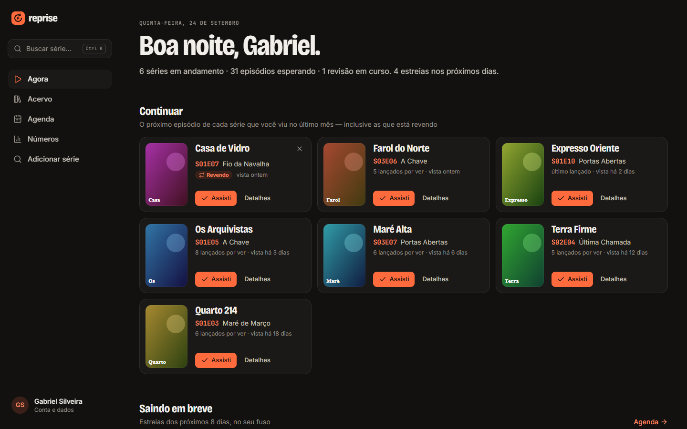
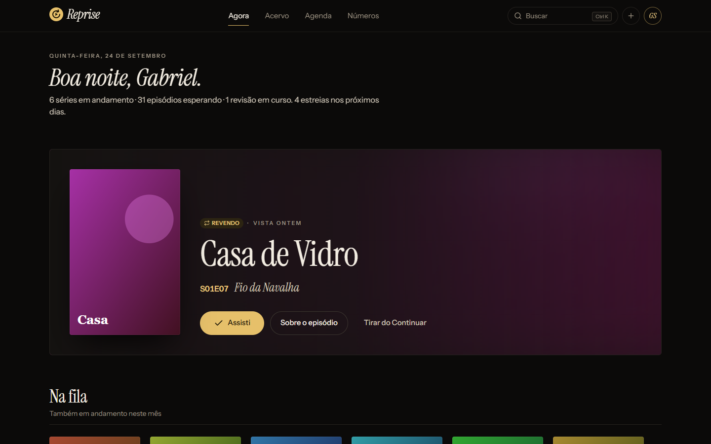
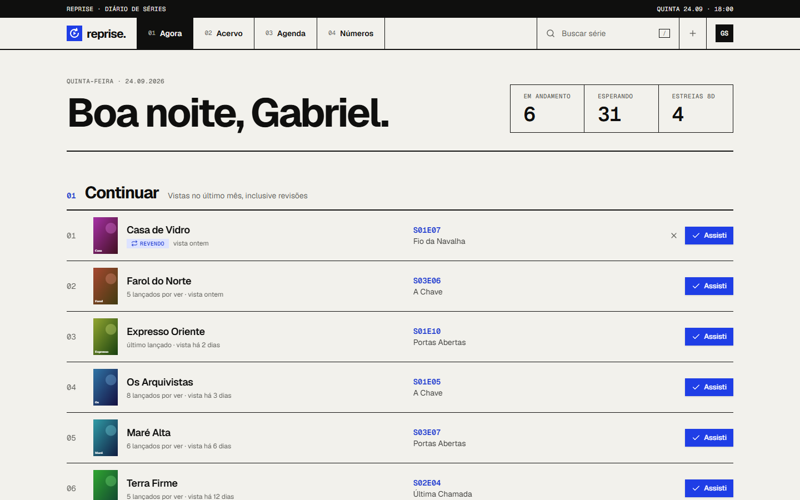
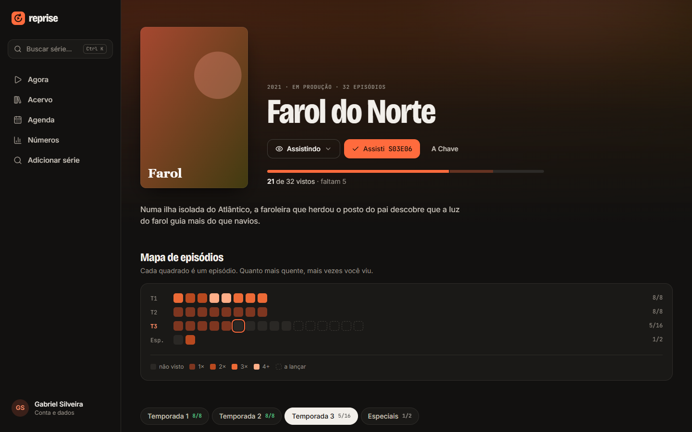
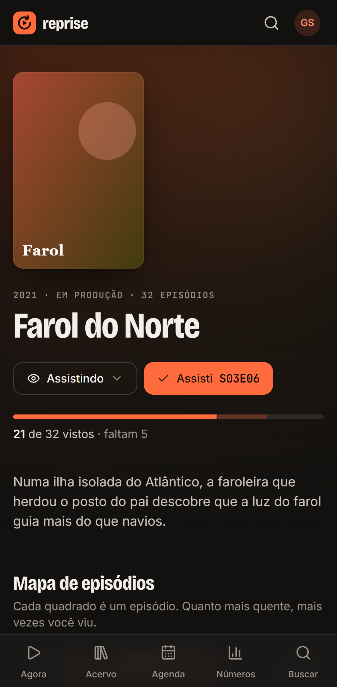
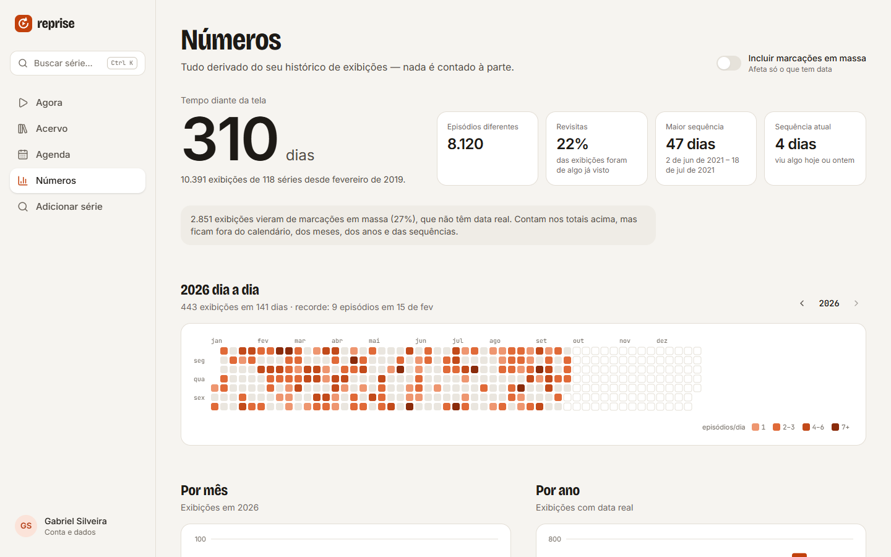
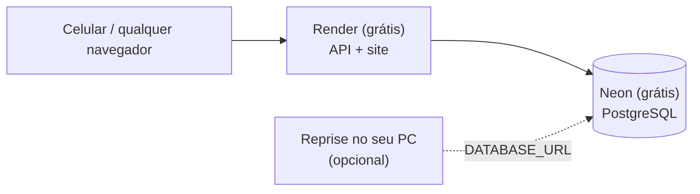
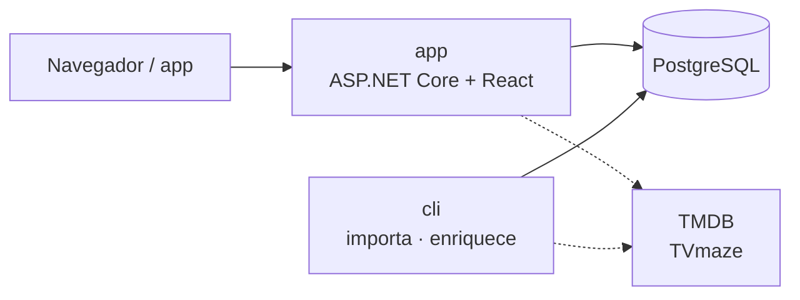

<div align="center">


# Reprise

**Um rastreador de séries auto-hospedado, feito em torno de reassistir.**

Nasceu quando o TV Time fechou e levou junto o histórico de todo mundo.

[](https://github.com/GabrielfSilveiraDev/reprise/actions/workflows/ci.yml)
[](LICENSE)


[English](README.md) · [Comece aqui](#comece-aqui) · [No seu computador](#no-seu-computador) · [De qualquer lugar](#de-qualquer-lugar-de-graça) · [No celular](#no-celular) · [Documentação](#documentação)



</div>

## Por quê

A maioria dos rastreadores guarda "visto" como uma caixinha marcada. Isso quebra na primeira vez
que você revê uma série: a caixinha já está marcada, e a segunda passada não deixa rastro. O
Reprise parte de uma regra só:

> **Uma exibição é um evento, não um booleano.**

Cada vez que você vê um episódio, uma linha entra em `watch_events`. Progresso, contagem de
revisões, sequências e estatísticas por mês são **derivados** desse log — nunca estado mutável
mantido em sincronia.

## O que ele faz

- **Importa o TV Time** — lê o export do pedido de GDPR, de forma idempotente (rodar de novo não
  duplica nada) e com um relatório de conferência que prova que toda linha foi contabilizada.
- **Agora** — o próximo episódio de cada série vista no último mês, revisões incluídas, marcado
  com um toque e com "Desfazer".
- **Mapa de episódios** — um quadrado por episódio, na cor de quantas vezes você o viu.
- **Agenda de estreias** — o que vai sair, no *seu* fuso, juntando as datas do TMDB com os
  horários do TVmaze: data sem fuso é como um episódio aparece "estreou hoje" um dia antes.
- **Números** — tempo diante da tela, sequências, calendário do ano e para onde foi o seu tempo,
  cada gráfico com a tabela por trás.
- **Três designs**, cada um com tema claro e escuro, escolhidos por navegador.
- **App no celular** — instalável pelo navegador (Android e iPhone) ou por APK, e que se atualiza
  sozinho.
- **Seus dados, portáveis** — export completo e reconstruível em JSON, com cada exibição.
- **Multiusuário** — cada pessoa com login e histórico próprios.

## Telas

| Brasa | Sessão | Grade |
|:---:|:---:|:---:|
|  |  |  |

<table>
  <tr>
    <td width="70%"></td>
    <td width="30%"></td>
  </tr>
  <tr>
    <td colspan="2"></td>
  </tr>
</table>

*As capturas saem da suíte de testes de ponta a ponta, contra uma API simulada com séries inventadas.*

## Comece aqui

Escolha como quer usar. Dá para começar por um e passar para outro depois, levando o histórico.

| Quero… | Caminho | Custo | Precisa de |
|---|---|---|---|
| Usar no meu computador | [No seu computador](#no-seu-computador) | grátis | Docker |
| Usar de qualquer lugar, sem PC ligado | [De qualquer lugar](#de-qualquer-lugar-de-graça) | grátis | contas no Neon e no Render |
| Usar no celular | [No celular](#no-celular) | grátis | o Reprise hospedado (linha de cima) |

## No seu computador

### 1. Instale o Docker

O Docker roda o Reprise inteiro (banco, API e site) sem instalar mais nada. Baixe o
[Docker Desktop](https://www.docker.com/products/docker-desktop/) para Windows, macOS ou Linux,
instale e abra. Espere o ícone da baleia indicar que ele está rodando.

### 2. Baixe o Reprise

Com o [Git](https://git-scm.com/downloads):

```bash
git clone https://github.com/GabrielfSilveiraDev/reprise.git
cd reprise
```

Sem o Git: na página do projeto, **Code → Download ZIP**, descompacte e abra um terminal dentro
da pasta.

### 3. Suba

```bash
docker compose up -d --build
```

A primeira vez leva alguns minutos (o Docker baixa e compila tudo). Depois, abra
**http://localhost:8080**. Não é preciso configurar nada antes: o segredo dos tokens é gerado na
primeira partida. Para mudar a porta ou outras opções, copie o [`.env.example`](.env.example) para
`.env` e edite.

### 4. Crie a sua conta

O cadastro pela tela vem fechado (numa instância exposta, aberto é porta aberta). A conta sai pela
linha de comando:

```bash
docker compose run --rm cli passwd --email me@reprise.local --user seunome
```

Ele pede a senha duas vezes (10 caracteres ou mais), sem mostrá-la na tela. É o mesmo comando para
trocar a senha depois. Entre em http://localhost:8080 com o **usuário** (`seunome`) e a senha. `me@reprise.local` é a
conta-dona, criada junto com o banco — é nela que a importação do TV Time grava.

### 5. Traga o seu histórico do TV Time (opcional)

Ponha o `.zip` do export do TV Time numa pasta `gdpr-data`, dentro da pasta do projeto, e rode:

```bash
docker compose run --rm cli /data/seu-export.zip --dry-run   # confere, sem gravar nada
docker compose run --rm cli /data/seu-export.zip             # importa
docker compose run --rm cli enrich                           # completa capas e episódios pelo TMDB
```

O `enrich` e a busca de séries novas precisam de uma
[chave gratuita do TMDB](https://www.themoviedb.org/settings/api): ponha-a em `Tmdb__ApiKey` no
`.env` e rode `docker compose up -d` de novo. Todo o resto funciona sem ela.

### Dia a dia

| Para… | Rode |
|---|---|
| Parar | `docker compose stop` |
| Ligar de novo | `docker compose up -d` |
| Atualizar para a versão mais nova | `git pull` e `docker compose up -d --build --remove-orphans` |
| Trocar a senha | o comando do passo 4, com a senha nova |
| Ver o que deu errado | `docker compose logs app` |

O histórico fica no volume `reprise_reprise-pgdata` do Docker e sobrevive a parar, atualizar e
reiniciar o computador. **Nunca** use "Reset to factory defaults" no Docker Desktop: isso apaga os
volumes, e o histórico junto.

No Windows há também um [atalho que abre o Reprise com um clique](docs/windows.md) e fecha tudo
quando a janela fecha.

## De qualquer lugar, de graça

O Reprise hospedado no [Render](https://render.com), com o banco no [Neon](https://neon.com). Os
dois têm plano gratuito sem cartão, e o PC pode ficar desligado:



Em resumo (o passo a passo está em [Hospedagem](docs/hospedagem.md)):

1. Crie um projeto no Neon e copie a URL de conexão.
2. No Render, **New → Blueprint**, escolha o repositório e cole a URL. O
   [`render.yaml`](render.yaml) configura o resto.
3. Leve o histórico do computador para lá com um comando
   (`DATABASE_URL=<url do Neon>` no `.env` e `docker compose run --rm copiar-banco`), ou crie uma
   conta nova.

O plano gratuito do Render dorme depois de 15 minutos sem uso, e a primeira abertura depois disso
leva cerca de um minuto. Cada push na `main` que passa no CI é publicado sozinho.

**Só o banco online:** com `DATABASE_URL=<url do Neon>` no `.env`, o Reprise do seu computador
passa a usar o banco da nuvem. É o jeito de vários computadores compartilharem o mesmo histórico.

## No celular

Com o Reprise hospedado, ele vira app no celular, no design Brasa, e **se atualiza sozinho** a
cada deploy:

- **Pelo navegador** (Android e iPhone): abra o seu endereço e use **Instalar app** /
  **Adicionar à Tela de Início**. Nada a configurar.
- **APK do Android**: o GitHub Actions compila e publica o APK nos Releases. Configura-se uma vez.

Passo a passo em [App no celular](docs/android.md).

## Arquitetura



| | Stack |
|---|---|
| **API** (`apps/api`) | .NET 10, ASP.NET Core Minimal APIs, EF Core, PostgreSQL, ASP.NET Identity + JWT |
| **Web** (`apps/web`) | React 19, TypeScript, Vite, TanStack Router e Query, Tailwind CSS 4, Radix UI, Recharts, vite-plugin-pwa |
| **Android** (`apps/android`) | Trusted Web Activity gerada pelo Bubblewrap |
| **Testes** | xUnit + Testcontainers (Postgres de verdade), Vitest, Playwright |
| **Entrega** | Docker (uma imagem: API servindo o site), Render, GitHub Actions, Dependabot |

### Decisões de engenharia

- **Log de eventos append-only como fonte da verdade.** Nada que possa ser derivado é guardado,
  então uma revisão, uma exibição recolocada ou uma removida nunca deixa contador fora de sincronia.
- **Importação idempotente e conferível.** A chave natural de cada linha do CSV fica sob um índice
  único parcial, então reimportar só acrescenta o que falta. Invariantes duros (toda linha lida foi
  contabilizada) reprovam a execução; divergências contra as estatísticas do próprio TV Time só são
  registradas — nem elas batem com os registros dele.
- **Multi-tenant desde o dia 1.** Um filtro global do EF Core restringe toda consulta ao usuário
  atual. Passar de um usuário para vários foi trocar uma implementação de `ICurrentUser` — nenhuma
  consulta mudou.
- **Uma imagem, do PC à nuvem.** A API serve também o site, sob a mesma origem: um processo cabe
  nos 512 MB do plano gratuito, a sessão nunca cruza domínio e a API dispensa CORS. O mesmo
  container roda no docker-compose e no Render.
- **Contrato tipado de ponta a ponta.** Os tipos do web são gerados do OpenAPI da API, e o CI
  falha se o contrato versionado divergir do que a API publica.
- **Testes contra o que é de verdade.** Os de integração rodam num PostgreSQL descartável via
  Testcontainers, porque o que eles protegem (tradução para SQL, ordem dos nulos, isolamento entre
  usuários) é justamente o que um fake em memória deixaria passar.
- **Autenticação cuidadosa.** Token de acesso de 30 minutos, refresh de 60 dias rotativo e guardado
  só como hash, limite de tentativas por endereço no login e no código de validação, e cadastro
  fechado por padrão.
- **Um modelo, três designs.** Cada tela tem um modelo e uma vista por design; um `Record` sobre os
  nomes dos designs faz uma vista esquecida virar erro de compilação.

## Documentação

- [Hospedagem](docs/hospedagem.md) — Neon + Render, levar o histórico, cadeado de acesso
- [App no celular](docs/android.md) — instalar pelo navegador, APK, atualizações
- [Arquitetura e decisões](docs/arquitetura.md) — o log de eventos, os projetos .NET, autenticação, export
- [Importação e catálogo](docs/importacao-e-catalogo.md) — TV Time, enriquecimento pelo TMDB, agenda do TVmaze
- [Cliente web](docs/web.md) — telas, os três designs, o contrato da API
- [Desenvolvimento](docs/desenvolvimento.md) — rodar sem Docker, testes, CI
- [Windows](docs/windows.md) — abrir com um clique e testes com o Smart App Control

## Contribuindo

Issues e pull requests são bem-vindos — ver [CONTRIBUTING.md](CONTRIBUTING.md). Para relatar uma
falha de segurança, siga o [SECURITY.md](SECURITY.md).

## Licença

[MIT](LICENSE) © Gabriel Silveira
